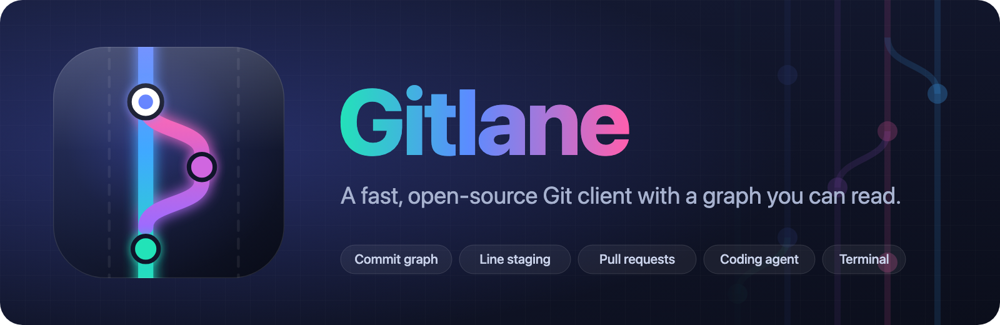
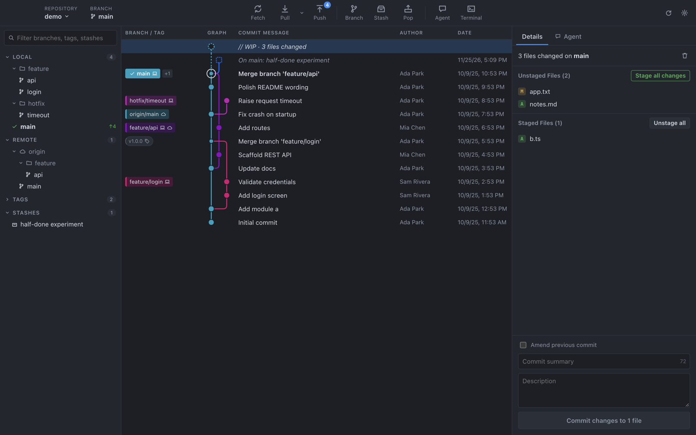
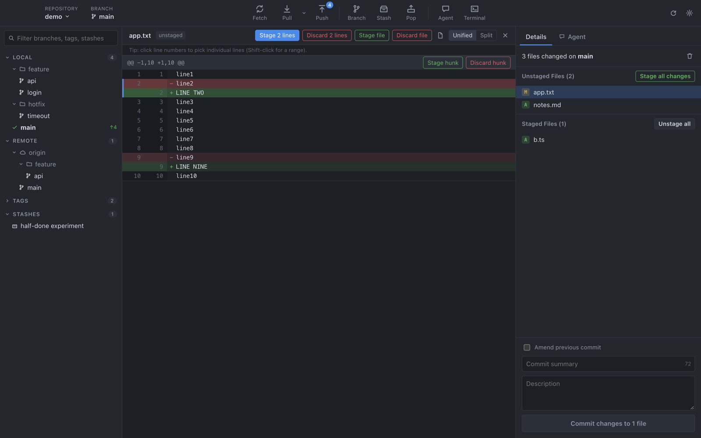
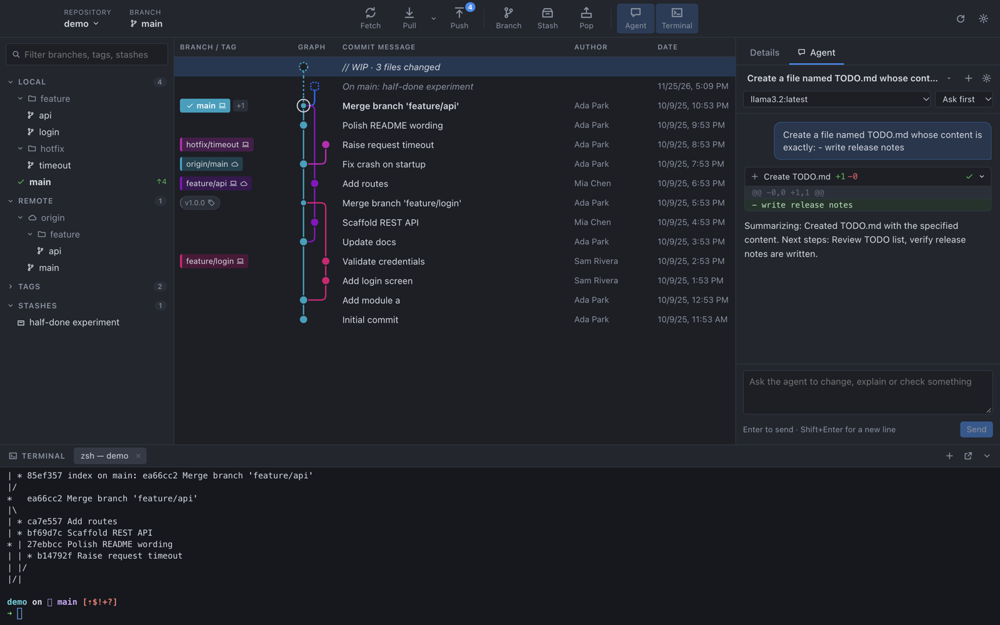
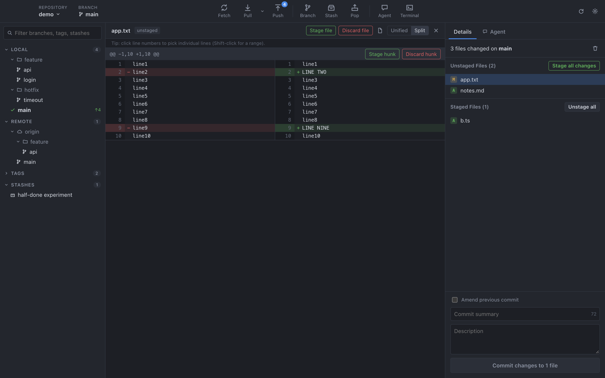
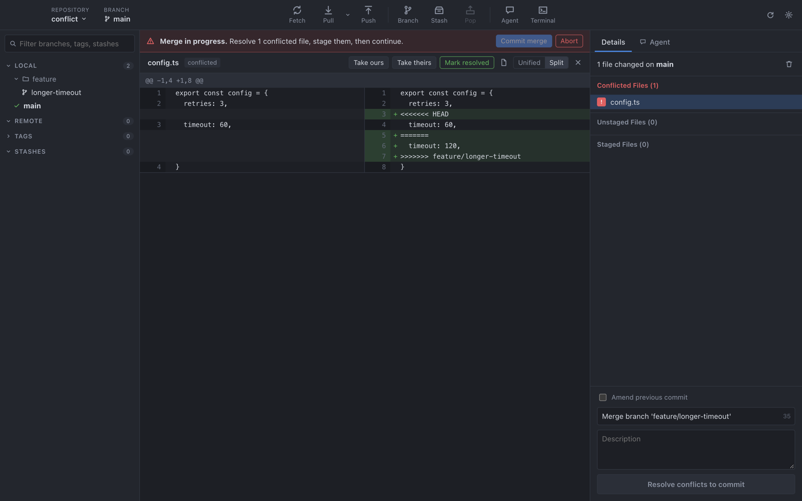
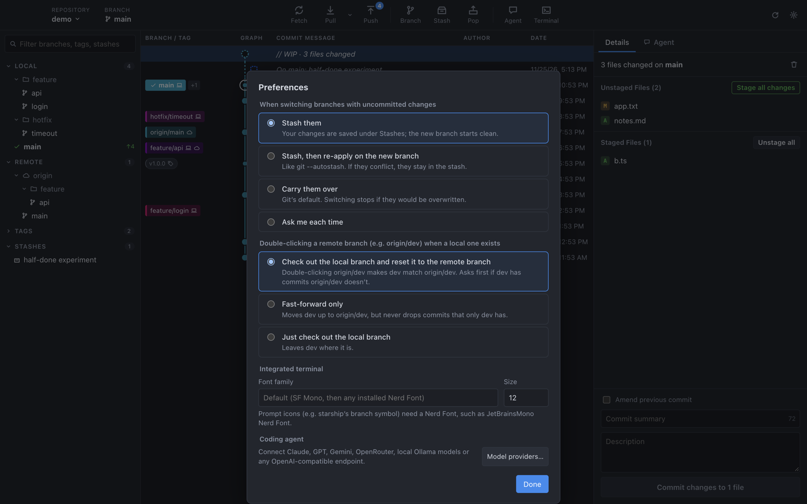
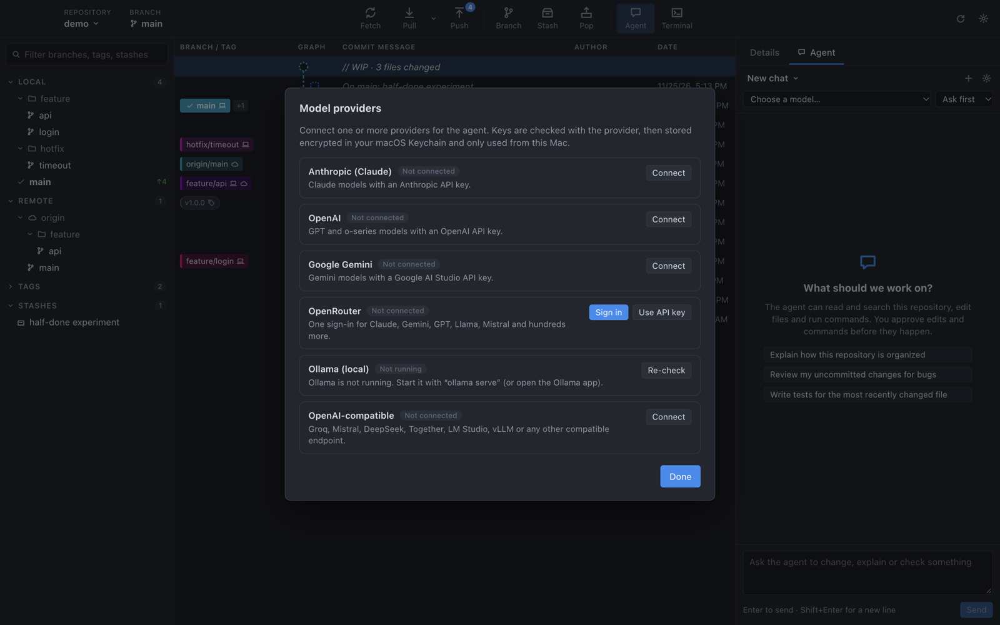
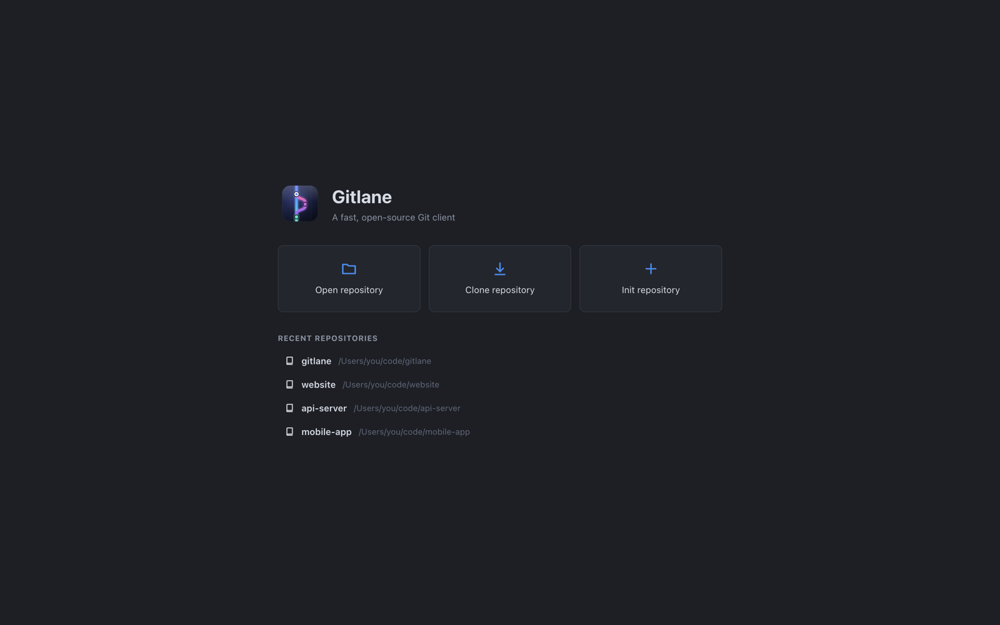

<p align="center">
  
</p>

<p align="center">
  <a href="https://github.com/alouini333/gitlane/releases/latest"></a>
  <a href="https://github.com/alouini333/gitlane/actions/workflows/ci.yml"></a>
  <a href="LICENSE"></a>
  
</p>

<p align="center">
  <b>Download:</b>
  <a href="https://github.com/alouini333/gitlane/releases/latest/download/Gitlane-mac-arm64.dmg">macOS (Apple silicon)</a> ·
  <a href="https://github.com/alouini333/gitlane/releases/latest/download/Gitlane-mac-x64.dmg">macOS (Intel)</a> ·
  <a href="https://github.com/alouini333/gitlane/releases/latest/download/Gitlane-win-x64-setup.exe">Windows</a> ·
  <a href="https://github.com/alouini333/gitlane/releases/latest/download/Gitlane-linux-x86_64.AppImage">Linux AppImage</a> ·
  <a href="https://github.com/alouini333/gitlane/releases/latest/download/Gitlane-linux-amd64.deb">Linux .deb</a>
</p>

---

Gitlane is a desktop Git client built around a clear, colorful commit graph, painless staging, and the everyday branch work one double-click away. It also handles GitHub pull requests, has a built-in terminal and comes with an optional coding agent. It runs the `git` you already have, so your config, hooks, credentials and SSH keys just work.

<p align="center">
  
</p>

## Features

**History you can read**
- Commit graph with colored lanes, merge curves, branch and tag labels (local and remote combined), a live `// WIP` node and stashes attached to their base commit.
- Search by message, author or SHA (⌘F), keyboard navigation, and smooth scrolling through large histories.

**Staging that stays out of your way**
- Stage or unstage whole files, single hunks or **individual lines**, in a unified or split diff.
- Commit with a summary and description, amend the last commit, discard changes, or add files to `.gitignore`.

**Branches without ceremony**
- Double-click to check out. Double-clicking a remote branch like `origin/dev` resets your local `dev` to it, and asks first if that would drop your local commits.
- Uncommitted changes are stashed automatically when you switch branches. In Preferences you can have them re-applied, carried over, or be asked each time.
- Merge, rebase, cherry-pick, revert, reset (soft, mixed, hard), tags and stashes from right-click menus.
- Guided conflict handling: continue, skip or abort, take ours or theirs, with the merge message prefilled.

**GitHub pull requests, without leaving the app**
- A sidebar of PRs filtered by *Review requests*, *Assigned to me*, *Created by me*, *Involves me* or *All*, with review and CI status.
- A full PR page: conversation, commits, checks and files changed.
- Comment on any line or range, start a review, then approve, request changes or comment. Reply to and resolve threads.
- Merge, squash or rebase. Edit, close and reopen PRs, toggle draft, and set reviewers, assignees and labels.
- Create PRs from any branch, and `@mention` people with autocomplete.

**Built-in terminal**
- A real shell (ctrl+\`) in the repository folder, with tabs. Colors, vim and pagers all work, and anything you do there shows up in the graph right away.

**Optional coding agent**
- Ask it to explain, change or check code (⌘L). It reads and searches the repo, edits files and runs commands.
- Edits and commands wait for your approval, with the diff or command shown first.
- Works with **Claude, GPT, Gemini, OpenRouter**, **local models via Ollama**, or any OpenAI-compatible endpoint. Keys are encrypted in your system keychain.

<table>
  <tr>
    <td></td>
    <td></td>
  </tr>
  <tr>
    <td align="center"><sub>Pick exactly the lines you want to stage</sub></td>
    <td align="center"><sub>The agent proposes, you approve; the terminal is one keystroke away</sub></td>
  </tr>
</table>

## Screenshots

<table>
  <tr>
    <td width="50%"></td>
    <td width="50%"></td>
  </tr>
  <tr>
    <td align="center"><sub>Split diff with per-hunk staging</sub></td>
    <td align="center"><sub>Resolve conflicts, then commit the merge</sub></td>
  </tr>
  <tr>
    <td width="50%"></td>
    <td width="50%"></td>
  </tr>
  <tr>
    <td align="center"><sub>Decide what happens to your changes when you switch branches</sub></td>
    <td align="center"><sub>Bring your own model: Claude, GPT, Gemini, OpenRouter or Ollama</sub></td>
  </tr>
  <tr>
    <td colspan="2"></td>
  </tr>
  <tr>
    <td colspan="2" align="center"><sub>Open, clone or create a repository</sub></td>
  </tr>
</table>

## Install

Grab the file for your system from the [latest release](https://github.com/alouini333/gitlane/releases/latest):

| System | File |
| --- | --- |
| macOS, Apple silicon | `Gitlane-mac-arm64.dmg` |
| macOS, Intel | `Gitlane-mac-x64.dmg` |
| Windows 10/11 (x64) | `Gitlane-win-x64-setup.exe` |
| Linux (x64) | `Gitlane-linux-x86_64.AppImage` or `Gitlane-linux-amd64.deb` |

Gitlane needs **Git 2.31 or newer** on your `PATH`.

> **The builds are not code-signed yet.**
> - **macOS:** on first launch, open *System Settings → Privacy & Security* and click **Open Anyway**. Or run `xattr -dr com.apple.quarantine /Applications/Gitlane.app`.
> - **Windows:** SmartScreen may warn you. Choose *More info → Run anyway*.
> - **Linux:** `chmod +x Gitlane-linux-x86_64.AppImage` before running it.
>
> Windows and Linux builds are newer and less tested than the macOS one. Please [report anything odd](https://github.com/alouini333/gitlane/issues/new/choose).

## Connecting accounts

- **GitHub:** pull requests use your [GitHub CLI](https://cli.github.com/) login (`gh auth login`), or `GITHUB_TOKEN` / `GH_TOKEN` if set. Public repositories work without signing in.
- **AI providers:** open the Agent tab (⌘L) and click the gear, or go to *Preferences → Coding agent*. Paste an API key, sign in with OpenRouter, or point it at Ollama or another endpoint. `ANTHROPIC_API_KEY`, `OPENAI_API_KEY`, `GEMINI_API_KEY` and `OPENROUTER_API_KEY` are picked up from the environment.

## Keyboard shortcuts

| Shortcut | Action |
| --- | --- |
| ⌘O | Open a repository |
| ⌘F | Search the graph |
| ↑ / ↓ | Move through commits |
| ⌘L | Toggle the coding agent |
| ctrl+\` | Toggle the terminal |
| ⌘, | Preferences |
| ⌘↵ | Commit or submit a comment |
| Esc | Close the diff or pull request |

(On Windows and Linux, use Ctrl instead of ⌘.)

## Build from source

```bash
git clone https://github.com/alouini333/gitlane.git
cd gitlane
npm ci
npm run dev        # run with hot reload
npm test           # unit and integration tests (needs git)
npm run dist:mac   # or dist:win / dist:linux
```

See [CONTRIBUTING.md](CONTRIBUTING.md) for the development workflow and [docs/ARCHITECTURE.md](docs/ARCHITECTURE.md) for a tour of the code.

## Roadmap

Ideas we'd love help with: interactive rebase, a three-way merge editor, blame and file history, multiple repository tabs, GitLab and Bitbucket support, emoji reactions on PRs, and web access and MCP servers for the agent. Check the [issues](https://github.com/alouini333/gitlane/issues) or open one.

## Contributing

Bug reports, ideas and pull requests are welcome. Start with [CONTRIBUTING.md](CONTRIBUTING.md), and please follow the [Code of Conduct](CODE_OF_CONDUCT.md). Found a security issue? See [SECURITY.md](SECURITY.md).

## License

[MIT](LICENSE) © Gitlane contributors.
